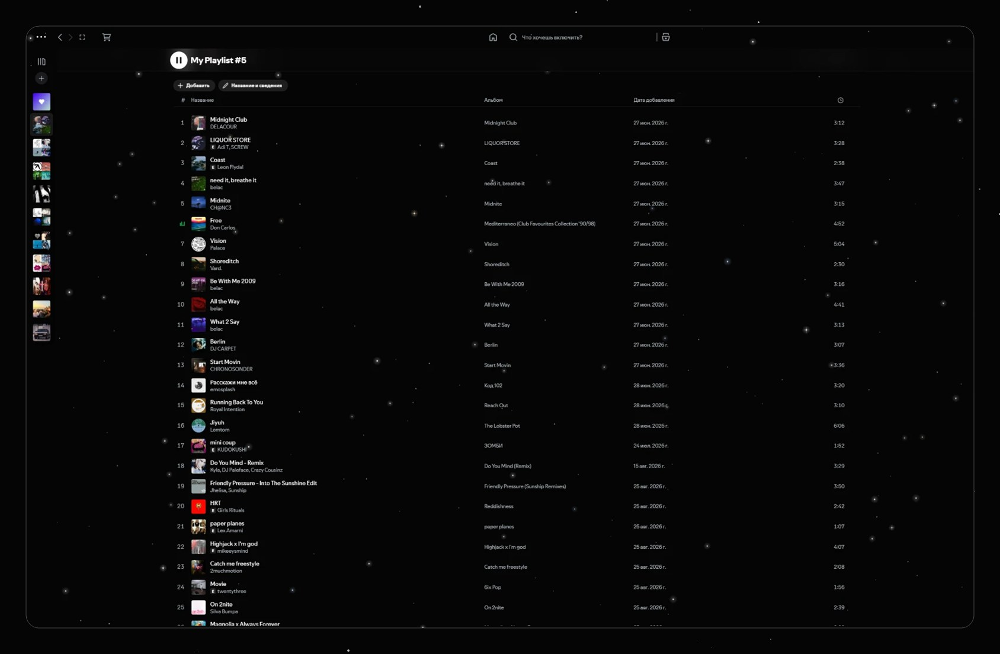
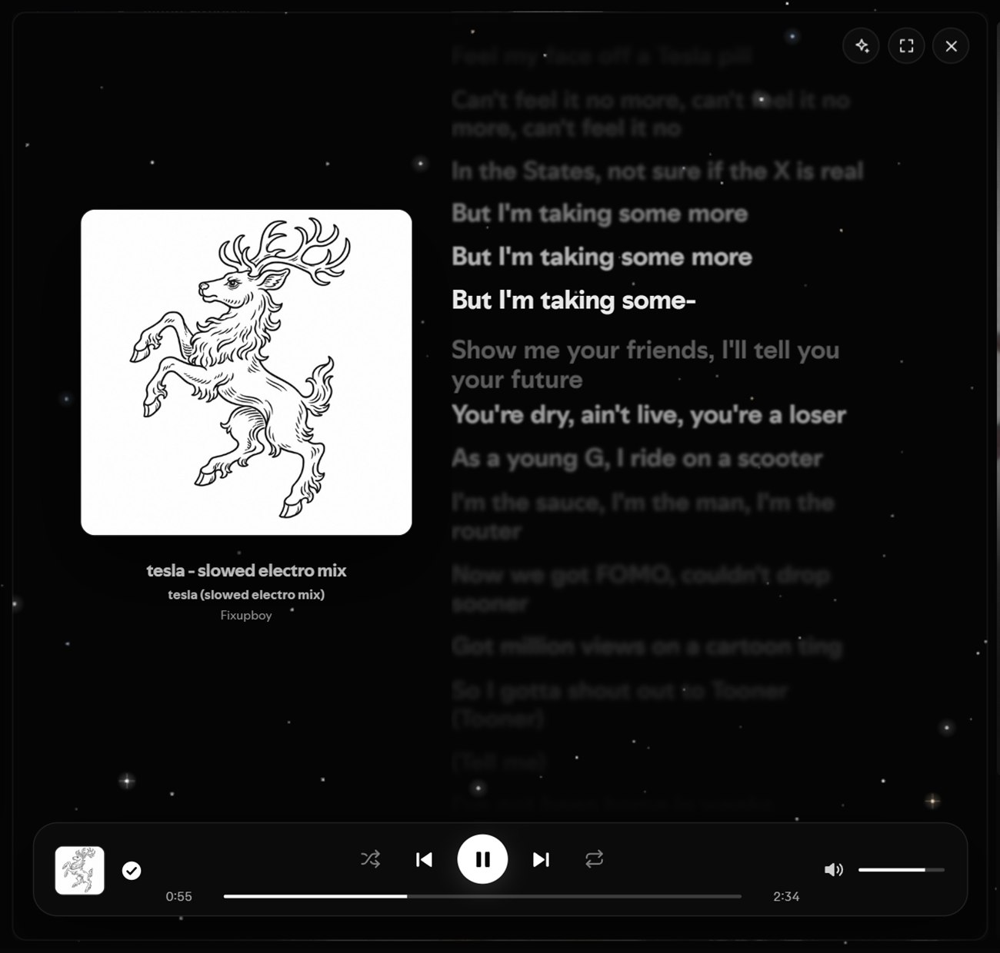
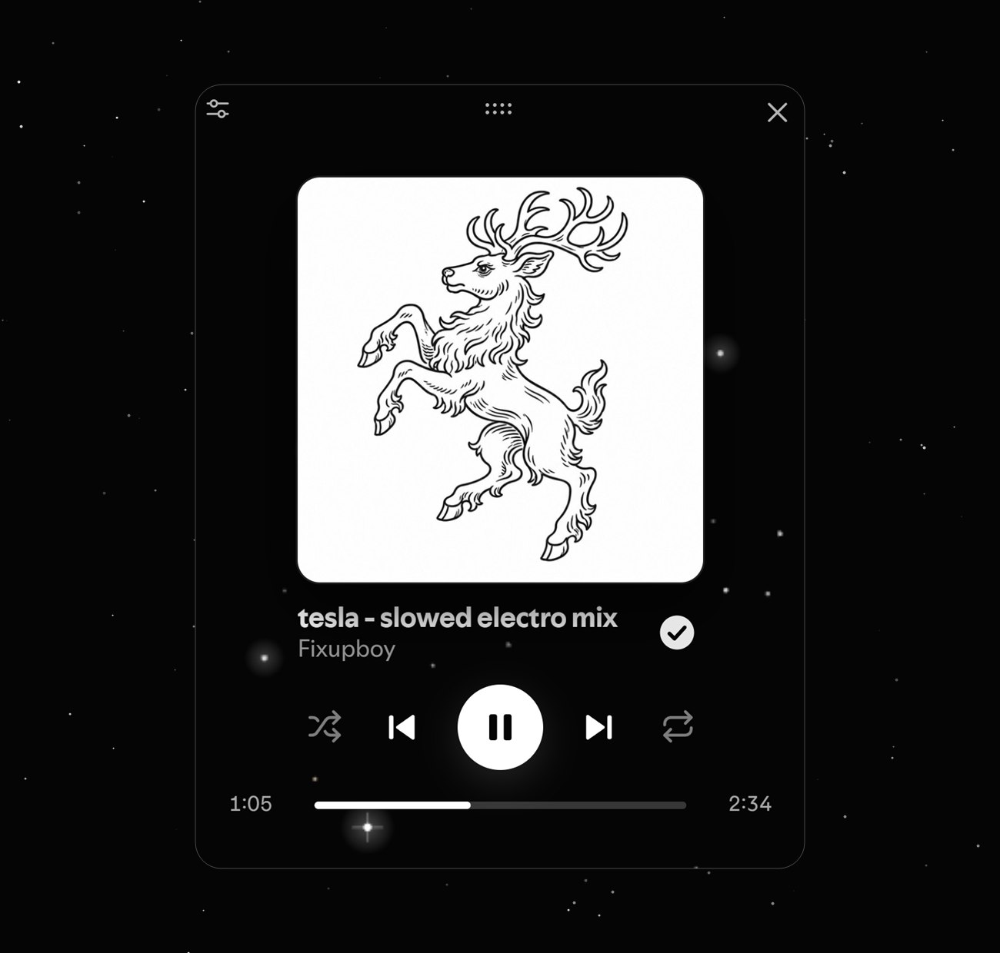
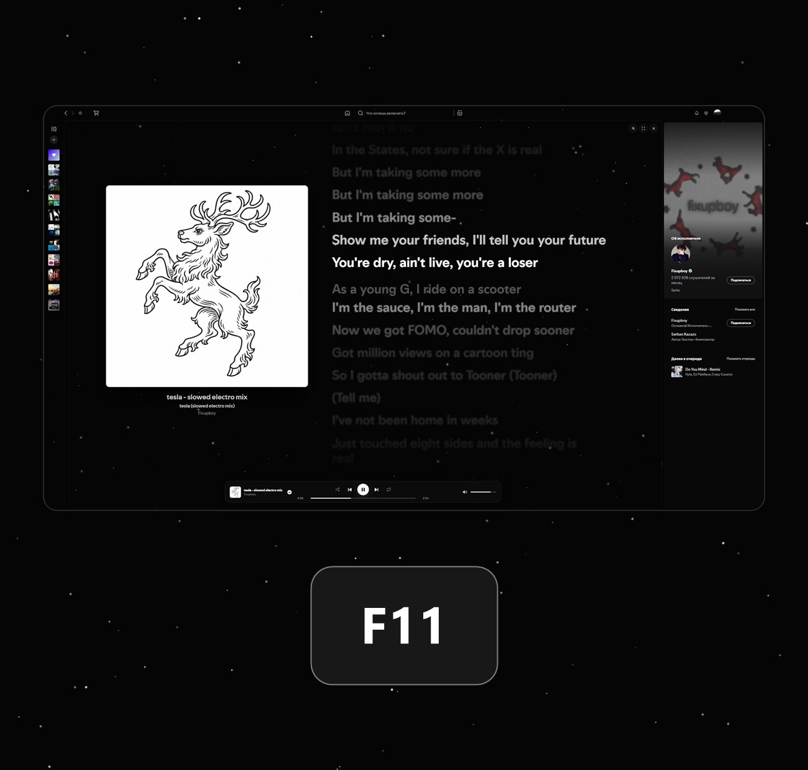

# Cosmic

Spotify, but black with stars. I made it for myself because the normal look bored me, then figured someone else might want it too.



It's five Spicetify extensions. They work separately, so install only the ones you like.

**Cosmic Sky** is the main one. Black background, stars drifting around, and now and then a little comet flies past. It also gets rid of the coloured stripes Spotify paints on playlist and artist pages, and the "Ctrl L" hint in the search box.

**Cosmic Motion** adds small animations. Pages fade in, cards lift when you hover over them, a like pops. The stars react to the music too: they flash on the beat, slow down when you pause, and a comet flies by on every new track. You need Cosmic Sky for that part.

**Cosmic Now Playing** is a page with a big cover and the lyrics. The words light up as they're sung. It has its own player bar at the bottom. A button with a star on it appears in Spotify's player bar and opens the page. The expand button (or Shift+F11) makes it fullscreen, and Esc closes it. In fullscreen, B switches the background between stars and the blurred cover.



**Cosmic Miniplayer** changes how the mini-player window looks. Small cover, the buttons are always there, drag the bar to seek. It works at any window size, even a thin strip.



**Cosmic Fullscreen F11** does what it says: F11 for fullscreen, Esc to get out.



Nothing changes in the normal window until you press one of the buttons.

## Install

From the Spicetify Marketplace: search for "Cosmic" and install what you want.

Or by hand: put the files you want in your Spicetify `Extensions` folder and run

```bash
spicetify config extensions cosmic-sky.js cosmic-motion.js cosmic-nowplaying.js cosmic-miniplayer.js cosmic-fullscreen.js
spicetify apply
```

Don't run Spicetify as administrator. It can leave Spotify with a black window.

## Things to know

- I only tested this on Windows with Spotify 1.3.6 and Spicetify 2.46. Spotify changes its pages from time to time, so something may break after an update. If it does, open an issue.
- The lyrics are Spotify's own, so you only get them for tracks that have them.
- The mini-player is a separate window drawn by Windows, so it can't be see-through.
- If "reduce motion" is on in Windows, the animations and the moving stars switch off.
- The extensions only talk to Spotify (lyrics, beat data, covers). Nothing goes anywhere else.

## По-русски

Хотел, чтобы Spotify выглядел как ночное небо, и сделал. Чёрный фон, звёзды, страница с текстом песни, свой мини-плеер и немного анимаций. Всё это пять отдельных расширений, ставь любые.

Ставится из Spicetify Marketplace (ищи «Cosmic») или руками, как написано выше. В обычном окне ничего не меняется, пока сам не нажмёшь кнопки. Кнопка со звездой в нижней панели плеера открывает страницу с текстом, Shift+F11 делает её на весь экран.

Проверял только на Windows. Если после обновления Spotify что-то сломается, напиши в issues.

## License

MIT, see `LICENSE`.
